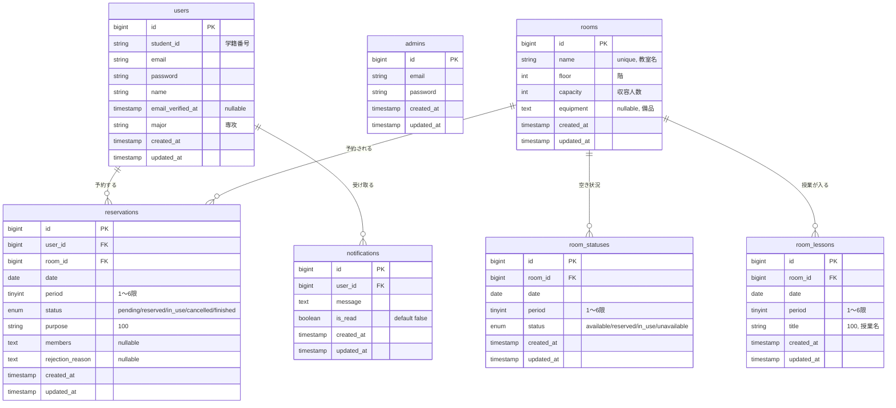

# Raqoo - 教室予約管理システム

## 概要

学校におけるアナログな教室予約管理をデジタル化し、リアルタイムでの空き状況確認と予約を可能にするWebアプリケーションです。  

学生はスマートフォンやPCから空き教室を検索し、最短の操作で簡単に予約リクエストを送信できます。  

管理者は届いたリクエストをオンラインで承認でき、授業スケジュールもシステム上で一元管理できます。

## 開発背景

これまでの教室予約は、学生が管理室へ足を運び、紙の表からその日の教室の空き状況を探して手書きで必要事項を記入する煩雑なプロセスでした。  

管理者側も、手書き文字の解読や対面対応に時間を取られ、窓口の混雑で他の対応が遅れるといった課題がありました。  

本アプリは、こうしたアナログ作業を解消し、どこからでも手軽に予約できる環境を目指して開発しました。システム化により業務効率を改善し、学生と管理者双方にとって使いやすい環境の構築を目指しています。

## 前提条件

- **Docker** と **Docker Compose** が利用できること
- **推奨環境**: Windows 11 または Ubuntu 24.04（Windows のみで動かすと Laravel の動作が重い場合があります）
- Docker Desktop を使う場合は、手順の前に **Docker Desktop を起動**しておいてください

### WSL2 (Ubuntu) で動かす場合（推奨・高速）

1. エクスプローラーのアドレスバーに `\\wsl$\Ubuntu` と入力し、WSL の Ubuntu 領域にアクセス
2. `\\wsl$\Ubuntu\home\{ユーザ名}\` を確認（なければ作成）
3. その中で本リポジトリをクローン
4. VS Code を使う場合: 拡張機能「WSL」を入れ、左下の「リモートウィンドウを開く」から「Ubuntu」を選択し、WSL 上でフォルダを開く

## クイックスタート

### 1. リポジトリのクローンと移動

```bash
# クローン後、プロジェクトルート（docker-compose.yml がある階層）に移動
cd /path/to/raqoo
```

ホスト側のパス例: Windows なら `C:\...\raqoo`、WSL/Ubuntu なら `/home/ユーザ名/raqoo`

### 2. Docker コンテナの起動

```bash
docker-compose up -d
```

### 環境変数 (.env) の設定

初回のみ、`raqoo/.env.example` をコピーして `raqoo/.env` を作成します。

- **Docker で動かす場合（推奨）**
コンテナ内（後述の「3. アプリの初期設定」の手順で `/var/www` に移動したあと）で `cp .env.example .env` と `php artisan key:generate` を実行してください。
`.env` の DB 設定は、Docker 用に次のようにします。
  ```
  DB_CONNECTION=mysql
  DB_HOST=db-appli4
  DB_PORT=3306
  DB_DATABASE=platform
  DB_USERNAME=dbuser
  DB_PASSWORD=dbuser
  ```
  すでに `raqoo/.env` が存在する場合はこの手順は不要です。
- **本番でメール送信（アカウント登録など）を使う場合**
`.env`で以下を設定してください
  ```
  MAIL_MAILER=smtp
  MAIL_HOST=smtp.gmail.com
  MAIL_PORT=587
  MAIL_USERNAME=
  MAIL_PASSWORD=
  MAIL_FROM_ADDRESS=
  MAIL_FROM_NAME="${APP_NAME}"
  ```

### 3. アプリの初期設定（コンテナ内で実行）

```bash
# PHP コンテナに入る
docker exec -it app-appli4 bash

# コンテナ内: Laravel のルートへ移動（マウント先は /var/www）
cd /var/www

# 依存パッケージのインストール
composer install

# 初回のみ（.env が無い場合）。既に .env がある場合はスキップ
cp .env.example .env

# アプリケーションキーの生成
php artisan key:generate

# データベースの初期化（マイグレーション + 初期データ投入）
php artisan migrate:fresh --seed

# コンテナから出る
exit
```

### 4. アクセス先

- **ユーザー（学生）ログイン**: [http://localhost:8881/login](http://localhost:8881/login)
- **管理者ログイン**: [http://localhost:8881/admin/login](http://localhost:8881/admin/login)
- **ユーザー用ホーム**: [http://localhost:8881/home](http://localhost:8881/home)
- **管理者ダッシュボード**: [http://localhost:8881/admin/dashboard](http://localhost:8881/admin/dashboard)

## ログイン情報（テストアカウント）

初期データ投入後、以下のアカウントでログインできます。

### ユーザー（学生）


| 名前   | メールアドレス                                           | パスワード       | 学籍番号  |
| ---- | ------------------------------------------------- | ----------- | ----- |
| ばやし  | [bayashi@example.com](mailto:bayashi@example.com) | 123456      | ST001 |
| 佐藤花子 | [sato@example.com](mailto:sato@example.com)       | password123 | ST002 |
| 山田次郎 | [yamada@example.com](mailto:yamada@example.com)   | password123 | ST003 |


ログインURL: [http://localhost:8881/login](http://localhost:8881/login)

### 管理者


| メールアドレス                                       | パスワード      |
| --------------------------------------------- | ---------- |
| [admin@raqoo.com](mailto:admin@raqoo.com)     | admin123   |
| [manager@raqoo.com](mailto:manager@raqoo.com) | manager123 |


ログインURL: [http://localhost:8881/admin/login](http://localhost:8881/admin/login)

## 基本的な使い方

### ユーザー（学生）側

1. **アカウント作成**  

  - ログイン画面の「サインアップ」から必要な情報を入力してアカウント登録を行う。  

  ※学校指定のメールアドレスでしか登録できない。
  - 登録すると確認メールが送信されるため、メール内のリンクをクリックしてアカウント登録を完了する。
2. **ログイン**  

  [http://localhost:8881/login](http://localhost:8881/login) でメールアドレスとパスワードを入力する。
3. **教室を予約する**  

  ホーム画面（教室一覧）で日付・時間帯（1〜6限）を選択し、利用目的とメンバー名を入力して予約リクエストを送信する。
4. **予約状況の確認**  

  サイドバーの「予約一覧」で、承認待ち・承認済み・却下のステータスを確認する。
5. **予約のキャンセル**  

  予約一覧から対象を選び「キャンセル」をクリックする。

### 管理者側

1. **ログイン**  

  [http://localhost:8881/admin/login](http://localhost:8881/admin/login) で管理者用メールアドレスとパスワードを入力する。
2. **予約の承認・却下**  

  ダッシュボードの予約申請一覧（通知のベルアイコン）で「承認」または「却下」を実行する。却下する場合は理由を入力する。
3. **教室の予約状況確認**  

  ダッシュボードのカレンダー・テーブルで、日付・時間帯ごとの予約状況を確認する。
4. **授業情報の登録・キャンセル**  

  テーブルのセルをクリックし、予約のキャンセル、授業情報の登録、授業のキャンセルを行う。

## プロジェクト構成

```
raqoo/
├── app/
│   ├── Http/Controllers/
│   │   ├── Admin/          # 管理者機能
│   │   └── User/           # ユーザー機能
│   └── Models/             # データモデル
├── database/
│   ├── migrations/         # データベース構造
│   └── seeders/            # 初期データ
│       ├── AdminSeeder.php
│       ├── UserSeeder.php
│       ├── RoomSeeder.php
│       └── ...
├── resources/views/
│   ├── admin/              # 管理者画面
│   └── user/               # ユーザー画面
├── public/
└── routes/web.php          # ルーティング定義
```

## 技術スタック


| 項目       | 内容                        |
| -------- | ------------------------- |
| フレームワーク  | Laravel 12                |
| データベース   | MariaDB（MySQL 互換）         |
| フロントエンド  | Blade, Tailwind CSS, Vite |
| インフラ     | Docker, Docker Compose    |
| Web サーバー | Nginx                     |
| PHP      | 8.3（コンテナ内）                |


## 技術選定の意図

### サーバーサイド：Laravel 12（PHP 8.3）

- 習得済みスキルの活用と深化：これまで学習してきた PHP の知識を活かしつつ、モダンな開発手法を取り入れるため、シェア率が高くエコシステムも充実しているLaravelを採用しました。
- MVCアーキテクチャの徹底：関心事の分離（責任分担）を実践的に学ぶため、標準的なディレクトリ構造を持つLaravelを選択しました。ビジネスロジックと表示ロジックを分離し、保守性の高い実装を優先しています。

### データベース：MariaDB

- リソースの最適化：MySQL との互換性を維持しつつ、VPSの限られたリソース（メモリ・ストレージ）でも安定して運用しやすい選択肢としてMariaDBを採用しました。

### インフラ：Docker / Docker Compose

- チームでの導入・環境構築のしやすさ：「自分の環境では動くが、他人の環境や本番では動かない」といった問題を避けるため、開発初期からコンテナ化を前提にしました。
- 本番環境へのデプロイのしやすさ：ローカルで動作確認済みの構成をそのままVPS（本番環境）でも再現できるため、本番サーバーでの環境構築ミスや予期せぬエラーを減らすことを目的としています。

### Webサーバー：Nginx

- パフォーマンスと拡張性：軽量でメモリ消費を抑えつつ、高い並行処理性能が期待できるためNginxを採用しました。
- リバースプロキシとしての運用：Webサーバーとアプリケーション実行環境を分けることで、それぞれのキャッシュやセキュリティなどの設定を独立して管理しやすくしました。

## データベース ER 図




## トラブルシューティング

### ログインできない

- データベースを初期化し直す: コンテナ内で `php artisan migrate:fresh --seed` を再実行
- ブラウザのキャッシュを無効にして再読み込み（Ctrl+Shift+R など）

### 画面が真っ白になる

- Laravel のログを確認: コンテナ内では `/var/www/storage/logs/laravel.log`
- コンテナが起動しているか確認: `docker-compose ps`

### データベース接続エラー

Docker 利用時は、`.env` の DB 設定がコンテナ環境と一致しているか確認してください。

```
DB_CONNECTION=mysql
DB_HOST=db-appli4
DB_PORT=3306
DB_DATABASE=platform
DB_USERNAME=dbuser
DB_PASSWORD=dbuser
```

`docker/db/sql/init.sql` で DB 名 `platform` とユーザー `dbuser` が作成されます。

### Composer がインストールされていない / コマンドが見つからない

Composer は Docker イメージに含まれているため、**コンテナ内**で実行してください。ホスト側で実行しているとこのエラーになります。

1. コンテナに入る:

```bash
docker exec -it app-appli4 bash
```

1. コンテナ内で Laravel のルートに移動し、Composer を実行する:

```bash
cd /var/www
composer install
```

このあと、画面で **Permission denied on storage/framework/views** が出る場合は、次の項目を参照してください。

### Permission denied（storage / framework/views）

Laravel の画面で `storage/framework/views` などに対する Permission denied が出る場合、コンテナ内で storage に書き込み権限を付与します。

1. コンテナに入る:

```bash
docker exec -it app-appli4 bash
```

1. コンテナ内で以下を実行する:

```bash
cd /var/www
chmod -R 777 storage
```

- `-R`: 指定したフォルダ（`storage`）とその中身すべてに同じ権限を適用する
- `777`: 読み・書き・実行を全員に許可する（開発・検証用。本番サーバーではセキュリティリスクになるため、本番では適切な所有者・権限設定を行うこと）

## 詳細ドキュメント

- [開発ルール](./development-rules.md) - ブランチ命名・PR 運用など
- [リファクタリングチェックリスト](./refactoring-checklist.md) - 改善タスク一覧

